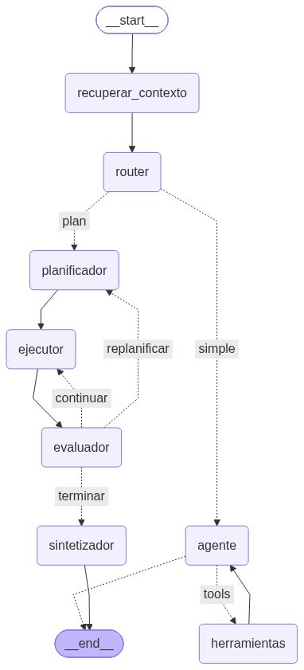

# Sinanzas: asistente de finanzas personales con LangGraph

Agente que registra gastos e ingresos, consulta y analiza finanzas, genera reportes y alertas, y planifica metas de ahorro. Proyecto de la Evaluación Parcial 2, ISY0101 Ingeniería de Soluciones con IA, Duoc UC.

Integrantes: Samuel Acosta, Matías Pineda y Samuel Marin

## Arquitectura

Flujo del grafo (LangGraph):
1. `recuperar_contexto`: busca en la memoria de largo plazo (FAISS) recuerdos relevantes del usuario.
2. `router`: clasifica la petición como `simple` o `plan`.
3. Ruta `simple`: `agente` ⇄ `herramientas` (ciclo ReAct con las 9 herramientas + `guardar_memoria`).
4. Ruta `plan`: `planificador` → `ejecutor` → `evaluador`. El evaluador decide `continuar`, `replanificar` (máx. 1 vez) o `terminar`. Luego `sintetizador` redacta la respuesta.
5. El `ejecutor` usa un sub-agente de solo lectura (consulta y cálculo, sin registrar ni modificar datos).

## Componentes

| Componente | Tecnología |
|---|---|
| Orquestación | LangGraph (StateGraph, ToolNode, conditional edges) |
| LLM | Gemini (`gemini-3.5-flash-lite`) vía `langchain-google-genai` |
| Memoria de corto plazo | `MemorySaver` (checkpointer por `thread_id`) |
| Memoria de largo plazo | SQLite (tabla `memorias`) + FAISS |
| Recuperación semántica | FAISS + `gemini-embedding-001` sobre guías financieras |
| Datos | SQLite (`gastos`, `ingresos`, `metas`, `memorias`) |

## Herramientas

`registrar_gasto`, `registrar_ingreso`, `crear_meta_ahorro`, `consultar_gastos`, `buscar_guias_financieras`, `detectar_gastos_hormiga`, `calcular_plan_ahorro`, `generar_alerta_categoria`, `generar_reporte_mensual`, `guardar_memoria`.

Los cálculos se hacen en Python/SQL; el LLM solo interpreta y explica los resultados.

## Cómo ejecutarlo

1. Abre `notebooks/sinanzas_agente.ipynb` en Google Colab.
2. Crea una API key en Google AI Studio y guárdala en **Secretos** de Colab con el nombre `GOOGLE_API_KEY` (activa "Acceso desde el notebook").
3. Ejecuta **Entorno de ejecución → Ejecutar todo**.
4. Para una demo limpia, ejecuta `reiniciar_demo()` y usa un `thread_id` nuevo en cada prueba.

## Evidencia de pruebas

Ver `tests/` y la última celda del notebook:
- Prueba 1: petición compleja, la meta no es alcanzable → planificación y replanificación.
- Prueba 2: cambia la condición (llega un bono) → el plan se adapta.
- Prueba 3: petición simple → ruta directa.

## Limitaciones

- Cuota gratuita de Gemini (15 solicitudes/min): se aplica un limitador de 12/min, lo que aumenta la latencia.
- La base SQLite es local a la sesión de Colab: se pierde al cerrarla.
- Las guías financieras son contenido de ejemplo.
- Sin protección contra el registro duplicado de un mismo gasto.
- El comportamiento del LLM es probabilístico.

## Uso de IA

Se utilizó Inteligencia Artificial (Claude/Deepseek) como apoyo para la estructuración del código base, depuración de errores y redacción de este archivo README. Sin embargo, la lógica del agente, las decisiones de arquitectura y las pruebas fueron diseñadas y validadas por el equipo.
